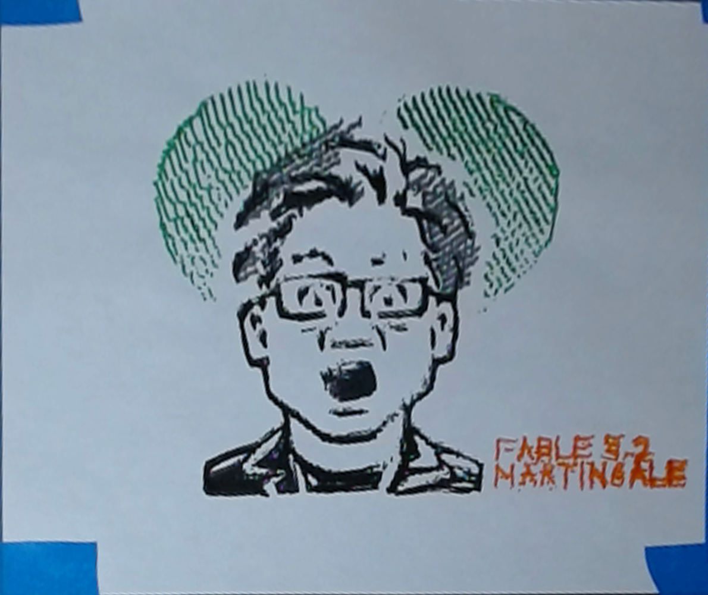
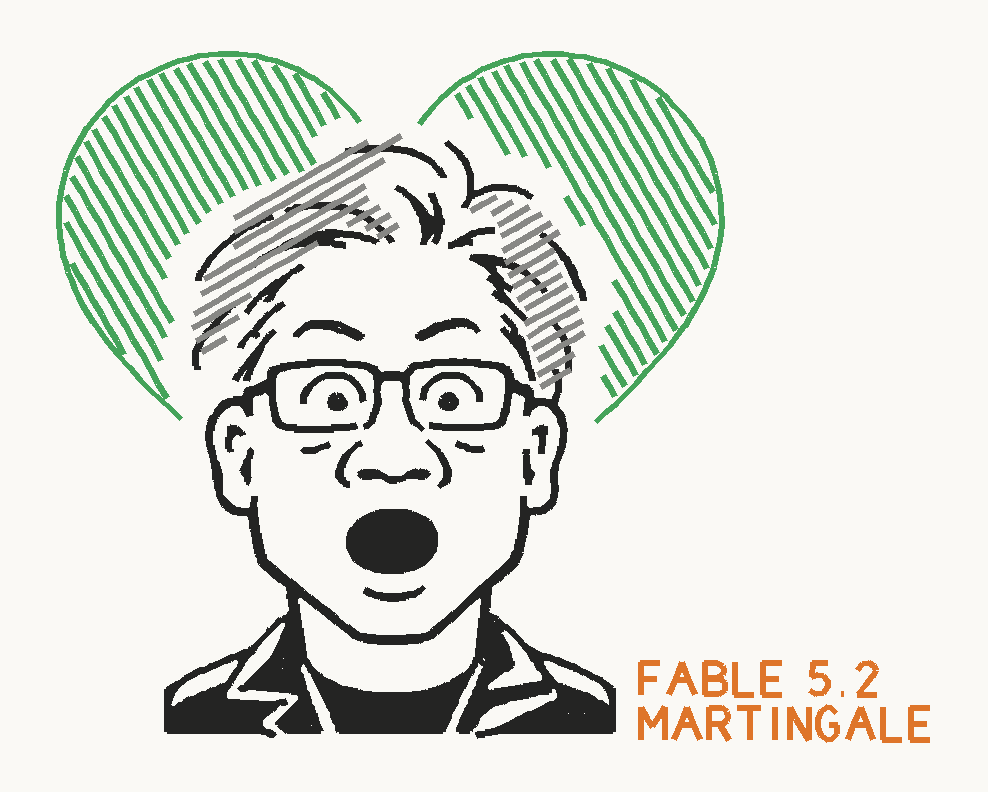
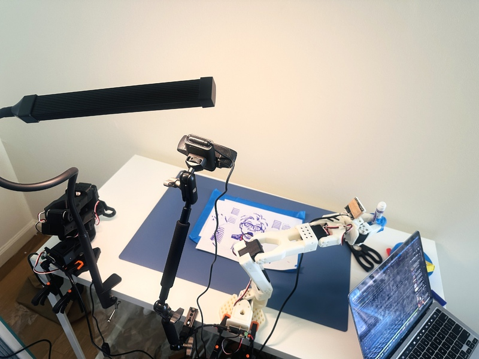
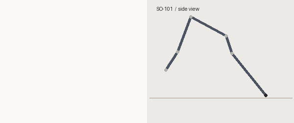

# Claude paints Jensen

Give Claude Code an SO-101 follower, four markers, and a sheet of paper. The arm draws Jensen Huang in black, hatches the green heart, shades his hair in grey, and signs the sheet in orange. This repository contains the 271 original stroke paths, a headless MuJoCo simulation, and a controller you can teach to your own desk.


| The original physical drawing | The same strokes in simulation |
| --- | --- |
|  |  |

[Try it in simulation](#draw-it-in-simulation) with just a computer, or use the shopping list below to draw it on paper.

## Get the code

Install Git and Python 3.12, then open a terminal and run the two commands below. To follow the guided setup, install [Claude Code](https://code.claude.com/docs/en/quickstart) and start it with `claude` in the project folder.

```sh
git clone https://github.com/vlongle/claude-paints-jensen.git
cd claude-paints-jensen
```

## What to buy

| Item | What you need it for | Where to buy |
| --- | --- | --- |
| Seeed Studio SO-ARM101 Pro assembled kit | The **follower** holds the marker. One powered, calibrated follower with a USB cable and base clamp is enough. | [Micro Center](https://www.microcenter.com/product/713942/so-arm101-pro-assembled-kit-lerobot-compatible-6dof-robotic-arm) |
| Crayola broad-line markers, 12-count | Use **black, green, grey (Dolphin Gray), and orange**, one at a time. | [Amazon](https://www.amazon.com/dp/B003HGGPLW) |
| White US Letter printer paper, 8½ × 11 inches | Use one sheet for the printed guide, one for the portrait, and a few for test marks. | [Amazon](https://www.amazon.com/dp/B01FV0F8H8) |
| ScotchBlue painter’s tape | Tape the sheet to a flat board and secure the marker to the fixed gripper jaw. | [Amazon](https://www.amazon.com/dp/B00004Z4DU) |
| Logitech C920 USB webcam | Optional. It gives you a fixed overhead view for checking marks between passes. | [Amazon](https://www.amazon.com/dp/B006JH8T3S) |
| NEEWER desk-clamp camera arm | Optional with the webcam. Choose a mount with a desk clamp and a ¼-inch screw for the C920. | [Amazon](https://www.amazon.com/dp/B0B4B314CG) |



## Draw it on paper

1. Clamp the follower to a sturdy desk. Secure a flat board within reach. If you use the webcam, frame the whole page as shown above.
2. Print the [US Letter registration guide](assets/registration-letter.pdf) in **landscape at 100% (Actual Size)**. With a ruler, check that the outer crosses are **136 mm apart horizontally and 108 mm vertically**. Have an **8 mm spacer** ready for teaching the lifted marker position.
3. Open Claude Code in this checkout and paste the prompt below. The [hardware guide](docs/hardware.md) covers calibration, fitting the black marker, and checking a stroke on scrap before switching to the final sheet.

   > Help me draw this portrait on my SO-101 follower. Read AGENTS.md and docs/hardware.md. Start with the simulation, then walk me through desk setup and the first black test mark.

## Draw it in simulation

Use Python 3.12 and a terminal in this checkout. The first install needs internet access. The simulation then runs locally on a CPU, including on a machine without a display.

```sh
python3.12 -m venv .venv
source .venv/bin/activate
python -m pip install -e .
python -m portrait sim
```

On Windows, activate the environment with `.venv\Scripts\Activate.ps1` in PowerShell. Open **out/sim/replay.gif** to watch the arm, or **out/sim/portrait.png** for the final sheet. The run also writes the MuJoCo scene, the joint trajectory, contact samples and a JSON report.



## Run it with Claude Code

Start `claude` in this checkout and paste:

> Reproduce the four-marker portrait. Read AGENTS.md. Run the simulation, inspect the drawing, and tell me how many strokes each marker makes. I’ll tell you when I’m ready to set up my follower.

You can also run each command directly from a terminal.

## What is being reproduced?

| Stage | Original stroke paths | Subject |
| --- | ---: | --- |
| Black | 153 | Jacket, hair, glasses and face |
| Green | 45 | Heart |
| Grey (`gray` in commands) | 28 | Hair shading |
| Orange | 45 | Handwritten “FABLE 5.2 / MARTINGALE” |

The photographed run used 18 drawing passes and about 44 minutes of arm movement. Some strokes were retraced when a marker barely touched. The default simulation draws each path once. The portable controller fits the artwork inside a 136 × 108 mm teaching rectangle and preserves its proportions. The signed picture on another arm will vary with nib width, compliance and registration. [Original pass counts and timings](assets/original-passes.csv)

Both modes use the same page coordinates, pen lifts, five-joint kinematics and path planner. MuJoCo positions the joints and checks nib–paper contact at each planned pose. It models ideal joint tracking and a rigid nib. Ink flow, servo lag, flex and grasping a new marker are physical variables you check at the desk. The original robot produced the photograph. The portable hardware adapter in this release has been exercised with a simulated motor bus and still needs a fresh physical run on a reader’s setup.

The exact input is [strokes.json](portrait/strokes.json). The original canvas extends beyond both zero and one. The loader fits its complete bounding box in physical units so the heart and the signature both fit on the page. The [run notes](docs/run-notes.md) explain the marker and pressure decisions behind the film.

```sh
python -m unittest discover -s tests -v
```
